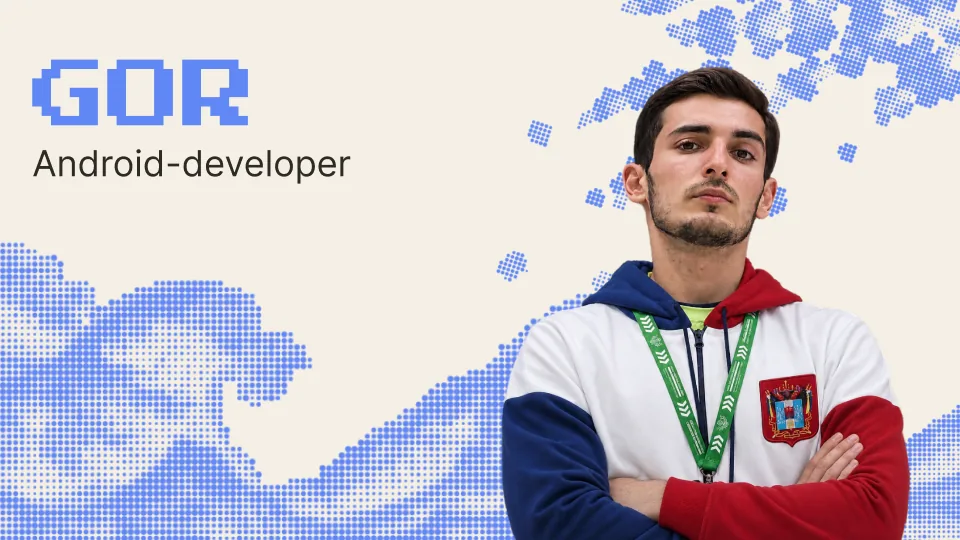

# GOR

<i>Software Developer</i>

 

### Стэк и инструменты

### Текущий фокус

- **Разработка:** <i>Мобильные и кроссплатформенные клиенты на **Jetpack Compose** / **Compose Multiplatform**.</i>
- **Проект:** Работа над расписанием 
- **Архитектура и библиотеки:** <i>Coroutines, Flow, Koin, Ktor, Room, Clean Architecture.</i>
- **Автоматизация и боты:** <i>Разработка сервисов, Telegram-ботов и AI-агентов.</i>

### Статистика GitHub

© gorogannisan

